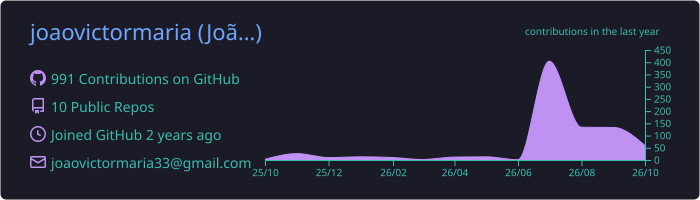
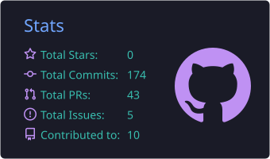
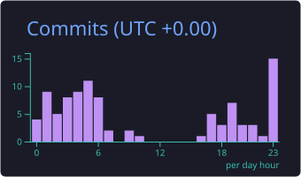
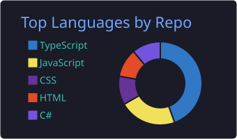
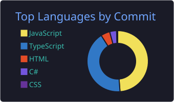

<!-- Banner -->
<p align="center">
  
</p>

<p align="center">
  
</p>

<p align="center">
  
  
  
</p>

---

### `> whoami`

```csharp
public class JoaoVictor : Developer
{
    public string Localizacao => "Aracaju, SE 🇧🇷";
    public string Formacao    => "Formado em Análise e Desenvolvimento de Sistemas";

    public string[] Estudando => ["C#", ".NET", "Aprimorando conhecimentos!"];
    public string[] Construo  => ["SaaS B2B", "Apps full-stack", "Landing pages"];

    public bool AbertoAOportunidades => true; // Dev júnior · PJ ou CLT
    public bool AbertoACooperacao    => true; // Bora construir algo juntos?
}
```

---

### `> experiencia --profissional`

```yaml
- cargo:   Estagiário de Desenvolvimento
  empresa: PawKeepr
  periodo: jul/2025 → jul/2026
```

---

### `> stack --list`

<table>
  <tr>
    <td align="center"><b>Linguagens</b></td>
    <td></td>
  </tr>
  <tr>
    <td align="center"><b>Front-end</b></td>
    <td></td>
  </tr>
  <tr>
    <td align="center"><b>Back-end & Dados</b></td>
    <td></td>
  </tr>
  <tr>
    <td align="center"><b>Ferramentas</b></td>
    <td></td>
  </tr>
</table>

---

### `> projetos --destaque`

<table>
  <tr>
    <td width="50%" valign="top">
      <h4>📂 <a href="https://github.com/joaovictormaria/veldocs">VELDOCS</a></h4>
      <sub>SaaS B2B de gestão inteligente de documentos empresariais</sub><br/><br/>
      
      
      
    </td>
    <td width="50%" valign="top">
      <h4>🍕 <a href="https://github.com/joaovictormaria/velnoxia-APP">Velnox APP</a></h4>
      <sub>Painel administrativo e PDV white-label para pizzarias</sub><br/><br/>
      
      
      
    </td>
  </tr>
  <tr>
    <td width="50%" valign="top">
      <h4>⛪ <a href="https://github.com/joaovictormaria/catholicae">Catholicaê</a></h4>
      <sub>Encontre igrejas católicas perto de você, com mapa e rotas</sub><br/><br/>
      
      
      
    </td>
    <td width="50%" valign="top">
      <h4>🐾 <a href="https://github.com/joaovictormaria/defender-of-the-little-ones">Defender of the Little Ones</a></h4>
      <sub>App mobile para denúncia de maus-tratos e proteção animal</sub><br/><br/>
      
      
      
    </td>
  </tr>
  <tr>
    <td width="50%" valign="top">
      <h4>🚀 <a href="https://github.com/joaovictormaria/velnox-ia">Velnox.IA</a> · <a href="https://velnox-ia.vercel.app">ver online ↗</a></h4>
      <sub>Landing page com painel admin e captação de leads</sub><br/><br/>
      
      
      
    </td>
    <td width="50%" valign="top">
      <h4>📘 <a href="https://github.com/joaovictormaria/estudos-csharp">Estudos C#</a></h4>
      <sub>Exercícios de C# e Programação Orientada a Objetos</sub><br/><br/>
      
      
      
    </td>
  </tr>
</table>

<p align="center">
  🌐 <b>Portfólio:</b> <a href="https://portifolio.velnoxia.com.br">portifolio.velnoxia.com.br</a>
</p>

---

### `> git log --stats`

<p align="center">
  
</p>

<p align="center">
  
  
  
  
</p>

<p align="center">
  
</p>

<p align="center">
  <picture>
    <source media="(prefers-color-scheme: dark)" srcset="https://raw.githubusercontent.com/joaovictormaria/joaovictormaria/output/github-snake-dark.svg" />
    
  </picture>
</p>

---

### `> contato --abrir`

<p align="center">
  <a href="mailto:joaovictormaria33@gmail.com"></a>
  <a href="https://instagram.com/victor.rodrigues.j"></a>
  <a href="https://portifolio.velnoxia.com.br"></a>
</p>

<p align="center">
  
</p>
